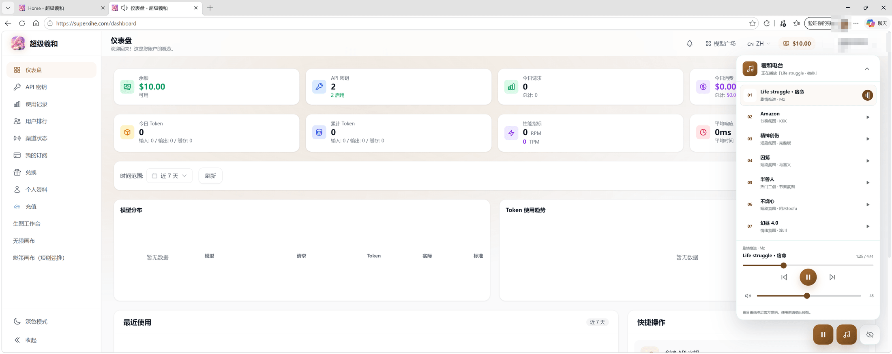
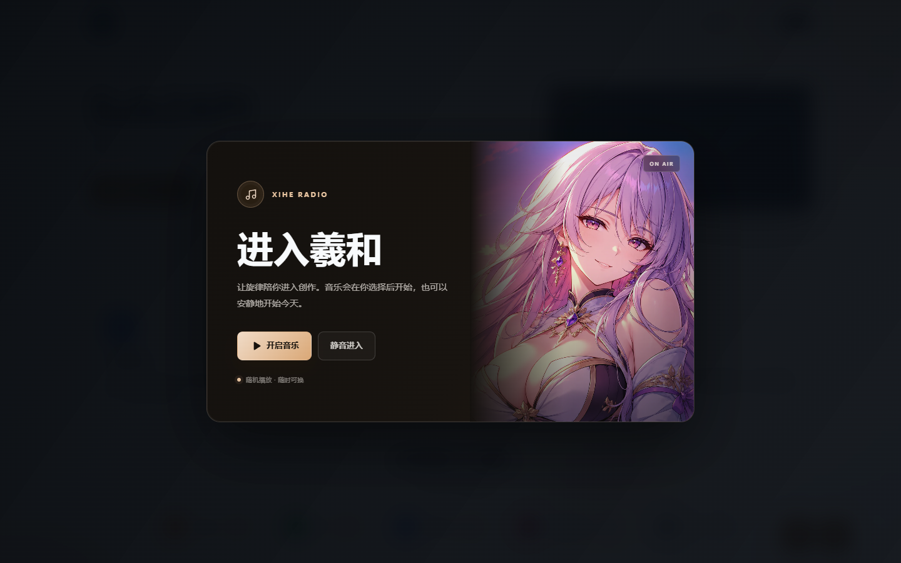
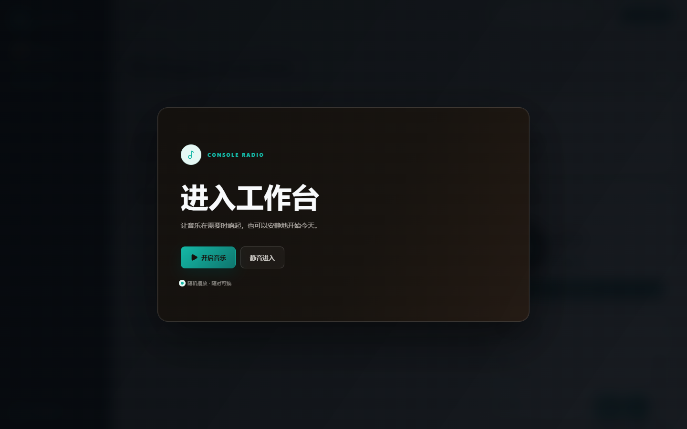
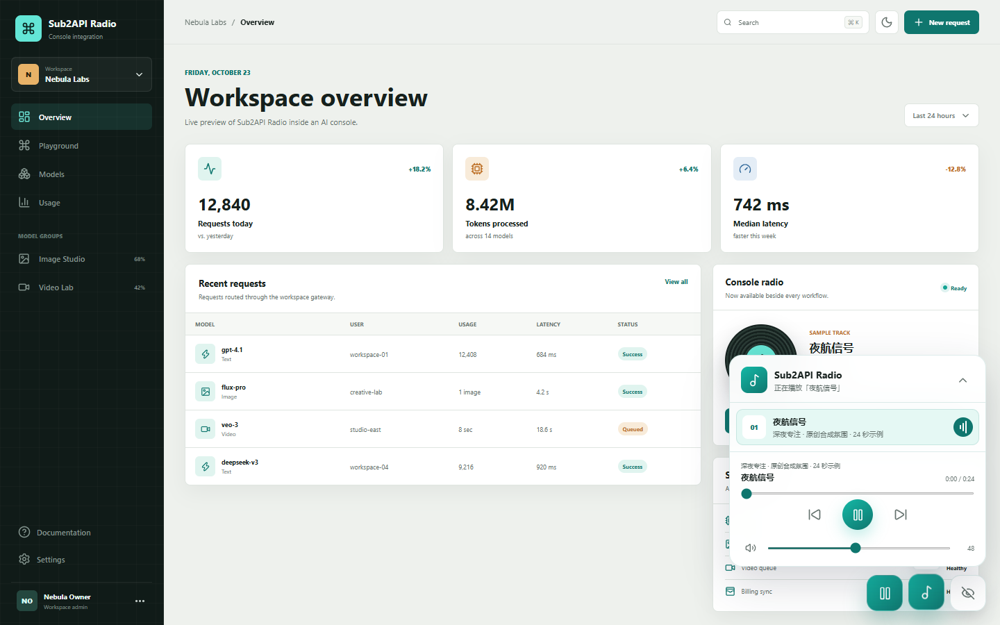
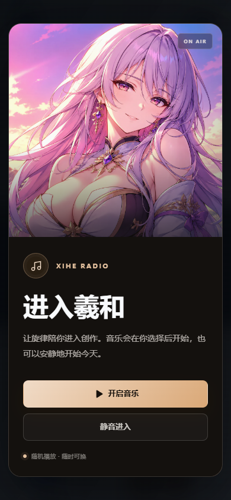

# 羲和电台 / Sub2API Radio

给 AI 控制台加一枚安静、不抢操作的氛围电台。

<div align="center">

**本项目由 [羲和 AI 中转](https://superxihe.com) 提供服务器与长期维护支持**

| Codex | Claude | 其他模型 |
| :-- | :-- | :-- |
| 福利 **0.045**<br>混池 0.075–0.12<br>企业 Pro 不降智 0.2 | Kiro **0.08**<br>正价 Kiro 0.21<br>满血 0.7 | DeepSeek · Grok<br>Gemini · Kimi · GLM |

`superxihe.com`（需魔法）· 视频模型专用站 `yingce.superxihe.com`

</div>

羲和电台是 Sub2API Radio 的实际主题示例：用一张品牌插画做首次进入卡片，把播放、随机队列、音量记忆和隐藏控制收进控制台右下角。项目本身仍保持通用，适合接入 Sub2API、模型控制台、创作工作台或任意 AI Web UI。





通用组件不绑定品牌素材，传入 `intro` 时才显示首次进入卡片：





## 羲和主题示例

- 首次进入时可选择开启音乐或静音进入。
- 播放、暂停、音乐面板和隐藏按钮集中在右下角，操作时不用先展开面板。
- 每次加载重新打乱曲目顺序，一轮结束后再次洗牌。
- 桌面端使用双栏品牌卡片，移动端改为人物在上、操作在下的单栏布局。
- 支持深色主题和 Windows 强制颜色模式；强制颜色下会隐藏插画，优先保证文字和按钮可读。
- 示例中的人物插画和音乐由站点运营方自行替换。

<p>
  
</p>

> 仓库只提供通用播放器代码、示例音频和主题实现。热门歌曲、短剧原曲、人物插画及其他第三方素材不随代码许可证授权，使用前请确认你拥有相应权利。

## 特性

- 播放与暂停按钮紧邻音乐入口，不需要先展开面板。
- 每次加载随机打乱曲目，一轮结束后重新洗牌。
- 支持上一首、下一首、进度拖动、音量和静音。
- 记住音量与隐藏状态；隐藏后保留一个窄标签用于恢复。
- 首次进入提供开启音乐和静音进入两种选择，不绕过浏览器自动播放限制。
- 支持浅色和深色主题，桌面与移动端均有响应式布局。
- 不依赖 Pinia、Vue Router 或特定控制台框架。
- 示例曲由脚本程序化生成，仓库不包含热门歌曲或第三方录音。

## 本地运行

```bash
pnpm install
pnpm dev
```

测试与构建：

```bash
pnpm test
pnpm build
```

重新生成开源演示截图：

```bash
pnpm exec vite --host 127.0.0.1 --port 15200
pnpm capture:demo
```

脚本默认使用本机 Microsoft Edge，也可通过 `PLAYWRIGHT_CHROMIUM_EXECUTABLE` 指定浏览器路径，通过 `RADIO_DEMO_URL` 指定演示地址。

## 接入 Vue 3

把 `src/components/Sub2ApiRadio.vue`、`src/lib/types.ts` 和 `src/lib/shuffle.ts` 放进你的项目，然后传入自己的曲目：

```vue
<script setup lang="ts">
import Sub2ApiRadio from './components/Sub2ApiRadio.vue'
import type { RadioIntro, RadioTrack } from './lib/types'

const tracks: RadioTrack[] = [
  {
    id: 'focus',
    title: '夜航信号',
    mood: '深夜专注',
    description: '合成氛围 · 24 秒示例',
    src: '/audio/night-signal.wav',
    duration: 24,
  },
]

const intro: RadioIntro = {
  title: '进入工作台',
  description: '让音乐在需要时响起，也可以安静地开始今天。',
  kicker: 'CONSOLE RADIO',
  primaryLabel: '开启音乐',
  secondaryLabel: '静音进入',
  meta: '随机播放 · 随时可换',
}
</script>

<template>
  <Sub2ApiRadio
    :tracks="tracks"
    station-name="Console Radio"
    storage-key="my-console-radio"
    theme="dark"
    :intro="intro"
  />
</template>
```

组件属性：

| 属性 | 类型 | 默认值 | 说明 |
| --- | --- | --- | --- |
| `tracks` | `RadioTrack[]` | 必填 | 曲目列表 |
| `stationName` | `string` | `Sub2API Radio` | 面板标题 |
| `storageKey` | `string` | `sub2api-radio` | 浏览器本地存储键 |
| `initialVolume` | `number` | `48` | 首次使用的音量 |
| `theme` | `light \| dark` | `light` | 组件主题 |
| `intro` | `RadioIntro` | 不显示 | 可选的首次进入卡片；同一标签页会话只显示一次 |

`RadioIntro` 支持 `title`、`description`、`imageSrc`、`imageAlt`、`kicker`、`primaryLabel`、`secondaryLabel` 和 `meta`。不传 `intro` 时保持原有的纯播放器行为。

“开启音乐”会在点击后开始播放；“静音进入”只关闭卡片，不会自动播放。选择记录在 `sessionStorage`，存储键为 `${storageKey}:intro`。

### 可选的推广条

`intro.promo` 可以在首次进入卡片底部加一条推广信息，默认不渲染，适合给赞助方或自家站点引流：

```ts
const intro: RadioIntro = {
  // ...标题、描述等
  promo: {
    label: '羲和 AI 中转',
    items: ['Codex 0.045 起', 'Claude Kiro 0.08 起'],
    note: 'superxihe.com 需魔法',
    linkLabel: '做视频 ↗',
    linkHref: 'https://yingce.superxihe.com/',
  },
}
```

| 字段 | 类型 | 说明 |
| --- | --- | --- |
| `label` | `string` | 前缀标签，通常是站点名，会加粗 |
| `items` | `string[]` | 价格或卖点条目，渲染为 `A / B / C` |
| `note` | `string` | 括号内的补充说明 |
| `linkLabel` | `string` | 右侧按钮文字，默认「了解更多」 |
| `linkHref` | `string` | 右侧按钮链接；不填则只显示文字条 |

推广条是纯静态文本，不加载第三方脚本，也不影响播放、音量记忆和隐藏逻辑。开源默认不显示任何推广内容。

## 接入 Sub2API

如果只想在登录后显示，可以在 `frontend/src/App.vue` 中挂载：

```vue
<Sub2ApiRadio
  v-if="authStore.isAuthenticated"
  :tracks="backgroundMusicTracks"
  station-name="Sub2API Radio"
  storage-key="sub2api-radio"
  :theme="isDark ? 'dark' : 'light'"
  :intro="radioIntro"
/>
```

音频建议放在站点自己的静态目录，或通过对象存储和 CDN 分发。首次进入卡片中的品牌人物图也应由站点运营方自行准备。不要直接引用没有授权的短剧原曲、抖音热门歌曲、商业录音或第三方人物素材。

## 示例曲

`src/assets/night-signal.wav` 由 `scripts/generate-sample.mjs` 生成，仅用于演示播放器。重新生成：

```bash
pnpm generate:audio
```

## 兼容性

- Vue 3.4+
- 现代 Chromium、Firefox、Safari 和移动浏览器
- 需要支持 `localStorage` 和 HTML5 Audio

## 版权

代码以 MIT License 开源。音乐版权不随代码许可证授予；请仅使用你拥有播放和商业使用授权的音频。
