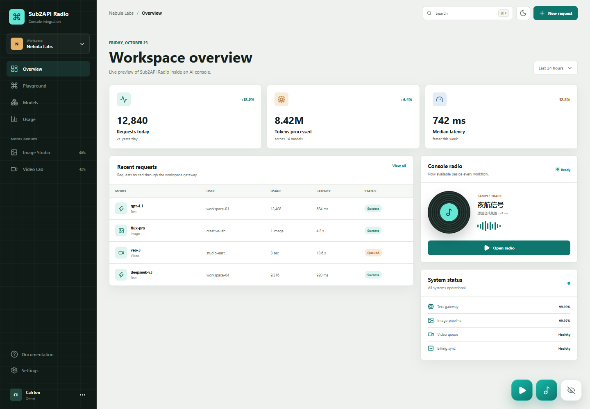

# Sub2API Radio

给 AI 控制台加一枚安静、不抢操作的氛围电台。

Sub2API Radio 是一个独立的 Vue 3 播放器组件。它提供右下角快捷播放、曲目面板、随机队列、音量记忆，以及可隐藏和恢复的按钮组，适合接入 Sub2API、模型控制台、创作工作台或任意 AI Web UI。



## 特性

- 播放与暂停按钮紧邻音乐入口，不需要先展开面板。
- 每次加载随机打乱曲目，一轮结束后重新洗牌。
- 支持上一首、下一首、进度拖动、音量和静音。
- 记住音量与隐藏状态；隐藏后保留一个窄标签用于恢复。
- 用户主动点击后才播放，不绕过浏览器自动播放限制。
- 支持浅色和深色主题，桌面与移动端均有响应式布局。
- 不依赖 Pinia、Vue Router 或特定控制台框架。
- 示例曲由脚本程序化生成，仓库不包含热门歌曲或第三方录音。

## 本地运行

```bash
pnpm install
pnpm dev
```

测试与构建：

```bash
pnpm test
pnpm build
```

## 接入 Vue 3

把 `src/components/Sub2ApiRadio.vue`、`src/lib/types.ts` 和 `src/lib/shuffle.ts` 放进你的项目，然后传入自己的曲目：

```vue
<script setup lang="ts">
import Sub2ApiRadio from './components/Sub2ApiRadio.vue'
import type { RadioTrack } from './lib/types'

const tracks: RadioTrack[] = [
  {
    id: 'focus',
    title: '夜航信号',
    mood: '深夜专注',
    description: '合成氛围 · 24 秒示例',
    src: '/audio/night-signal.wav',
    duration: 24,
  },
]
</script>

<template>
  <Sub2ApiRadio
    :tracks="tracks"
    station-name="Console Radio"
    storage-key="my-console-radio"
    theme="dark"
  />
</template>
```

组件属性：

| 属性 | 类型 | 默认值 | 说明 |
| --- | --- | --- | --- |
| `tracks` | `RadioTrack[]` | 必填 | 曲目列表 |
| `stationName` | `string` | `Sub2API Radio` | 面板标题 |
| `storageKey` | `string` | `sub2api-radio` | 浏览器本地存储键 |
| `initialVolume` | `number` | `48` | 首次使用的音量 |
| `theme` | `light \| dark` | `light` | 组件主题 |

## 接入 Sub2API

如果只想在登录后显示，可以在 `frontend/src/App.vue` 中挂载：

```vue
<Sub2ApiRadio
  v-if="authStore.isAuthenticated"
  :tracks="backgroundMusicTracks"
  station-name="Sub2API Radio"
  storage-key="sub2api-radio"
  :theme="isDark ? 'dark' : 'light'"
/>
```

音频建议放在站点自己的静态目录，或通过对象存储和 CDN 分发。不要直接引用没有授权的短剧原曲、抖音热门歌曲或商业录音。

## 示例曲

`src/assets/night-signal.wav` 由 `scripts/generate-sample.mjs` 生成，仅用于演示播放器。重新生成：

```bash
pnpm generate:audio
```

## 兼容性

- Vue 3.4+
- 现代 Chromium、Firefox、Safari 和移动浏览器
- 需要支持 `localStorage` 和 HTML5 Audio

## 版权

代码以 MIT License 开源。音乐版权不随代码许可证授予；请仅使用你拥有播放和商业使用授权的音频。
